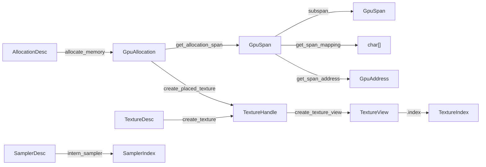
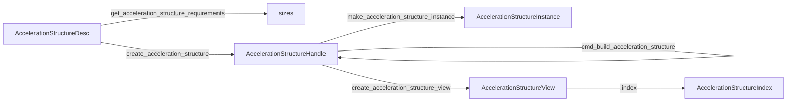

# Memory and resources

[Documentation](../index.md) › [Public API](index.md) › Memory and resources

Allocations, spans, addresses, textures, views, samplers, and acceleration
structures.

Recording, ending, or submitting commands does not retain application resources.
Keep them alive and unmodified as required until their last GPU use completes.
Destroy and update calls do not infer shader use or wait for completion.



## Allocations

```c3
gpu::AllocationDesc desc = {
    .size         = 64 * 1024,
    .alignment    = 16,                       // 0 selects 16
    .memory_class = gpu::MemoryClass.CPU_WRITE,
    .access       = { .graphics, .compute },  // queue roles that may touch it
    .debug_name   = "frame_data",
};
gpu::GpuAllocation allocation = gpu::allocate_memory(&device, &desc)!;
defer (void)gpu::free_allocation(&device, &allocation);
gpu::AllocationInfo info = gpu::get_allocation_info(&device, allocation);
```

| `MemoryClass` | Mapped | Addressable | Use |
|---|---|---|---|
| `CPU_WRITE` | yes | yes | upload staging read once by a copy |
| `CPU_WRITE_GPU_LOCAL` | yes | yes | root records, per-frame constants, CPU-written indirect arguments |
| `CPU_READ` | yes | yes | readback |
| `GPU_PRIVATE` | no | yes | device-local buffers |
| `TEXTURE` | no | no | backing for placed and sparse textures |

`allocate_memory` and `allocate_mapped_memory` require:

- `desc` is not null and `desc.size` is greater than 0;
- `desc.memory_class` is a defined `MemoryClass`;
- `desc.alignment` is zero or a power of two;
- `desc.access` is nonzero, names only known queue roles, and names only
  roles the device exposes (see `DeviceCaps.queues`);
- `desc.texture_requirements` is empty unless the class is `TEXTURE`, and a
  `TEXTURE` allocation has at least one requirement, each with a nonzero size,
  a power-of-two alignment and the compatibility value returned by
  `get_texture_requirements`, with `desc.size` covering every `size`; and
- for `allocate_mapped_memory`, `desc.memory_class` is a host-mapped class
  (not `GPU_PRIVATE` or `TEXTURE`).

Texture requirements whose compatibility values share no memory type fault
with `UNSUPPORTED_FEATURE`.

`AllocationInfo` reports the actual `mapped`, `coherent`, `device_local`,
and `addressable` properties. `CPU_WRITE_GPU_LOCAL` prefers a memory type
that is both device-local and host-visible and falls back to host memory
without a fault; `device_local` reports which one was selected.
`free_allocation` never waits; free only after
the last completion point that reads the memory. A live placed texture or
acceleration structure makes it return `RESOURCE_IN_USE`.

Allocation calls are thread-safe. Concurrent writes to overlapping mapped
bytes are the application's problem.

## Spans, mappings, addresses

A `GpuSpan` is a non-owning byte range inside an allocation.
`subspan`, `get_allocation_span`, `get_span_mapping` and `get_span_address`
return values rather than faults.

```c3
gpu::GpuSpan whole = gpu::get_allocation_span(&device, allocation);
gpu::GpuSpan part  = whole.subspan(256, 1024);            // range is a contract
gpu::GpuSpan fast  = whole.unchecked_subspan(256, 1024);  // no range or overflow rules

char[] bytes = gpu::get_span_mapping(&device, part);      // CPU_WRITE / CPU_READ only
gpu::GpuAddress address = gpu::get_span_address(&device, part);

gpu::MappedGpuSpan mapped = gpu::mapped_gpu_span(&device, part)!;  // span + bytes + address
gpu::GpuAllocation owner = part.allocation();                      // token for free_allocation
```

`subspan` requires `size` to be greater than 0 and `offset + size` not to
exceed the parent span's `size`, and the new base offset not to overflow.
`MappedGpuSpan.subspan` also requires `bytes.len` to equal `span.size` and the
derived GPU address not to overflow. `unchecked_subspan` applies none of
these rules.

`get_allocation_span` requires a buffer allocation, never a `TEXTURE` one.
`get_span_mapping`, `get_span_address`, `mapped_gpu_span`,
`flush_mapped_span` and `invalidate_mapped_span` require a span with
`size > 0` that lies within its buffer allocation; the mapping, mapped-span
and visibility calls also require a host-mapped class. Spans from
`get_allocation_span` and `subspan` satisfy these rules.

Every command that takes a `GpuSpan` requires it to be nonempty, and requires
it to hold the bytes the call's own arguments imply (for example `draw_count`
records of the indirect command type, or `index_count` indices). A span whose
required size comes from the device, such as an acceleration-structure
scratch range, must also cover that size. All of these are contracts: a
violation panics in safe builds. `allocate_memory` and `allocate_mapped_memory`
also require `desc.access` to name only queue roles the device selected.

`allocate_mapped_memory` allocates a mapped class and returns the same
three views in one call; free it through `span.allocation()`:

```c3
gpu::MappedGpuSpan frame = gpu::allocate_mapped_memory(&device, &desc)!;
gpu::GpuAllocation frame_allocation = frame.span.allocation();
defer (void)gpu::free_allocation(&device, &frame_allocation);
```

After writing through a mapping:

```c3
gpu::flush_mapped_span(&device, part)!;
```

After the GPU wrote and its completion point completed:

```c3
gpu::invalidate_mapped_span(&device, part)!;
```

Both are required unless `AllocationInfo.coherent` is true, in which case
they are no-ops. Neither waits for the GPU. A `GpuAddress` is a raw `ulong` valid until the allocation is
freed.

## Memory statistics

```c3
gpu::MemoryStats stats = gpu::get_memory_stats(&device);
String report = gpu::build_memory_report(&device, true);
defer report.free(mem);
```

`MemoryStats` holds up to `MAX_MEMORY_HEAPS` `MemoryHeapBudget` records,
the live allocation count, the texture count, the number of live texture
views holding a texture heap slot (`texture_view_count`), and the capacities
of three device tables:

- `texture_capacity`: the resolved texture table size,
  `RuntimeDesc.texture_capacity` or `DEFAULT_TEXTURE_CAPACITY` when zero.
- `allocation_capacity`: the bound on live `GpuAllocation` tokens, which are
  the results of `allocate_memory`, `allocate_mapped_memory` and
  `create_dedicated_texture`. `live_allocation_count` counts backend
  allocations, so the two are not comparable.
- `acceleration_structure_capacity`: the bound on live acceleration
  structures. It is 0 on a device created without ray queries or ray-tracing
  pipelines.

Numbers are advisory under concurrent allocation.

## Textures

```c3
gpu::TextureDesc desc = {
    .width        = 1024,
    .height       = 1024,
    .depth        = 0,            // 0 = 2D, >0 = 3D
    .mip_levels   = 0,            // 0 = 1
    .array_layers = 0,            // 0 = 1
    .format       = gpu::Format.RGBA8_SRGB,
    .usage        = { .sampled, .transfer_dst },
    .access       = { .graphics },
    .sample_count = gpu::SampleCount.ONE,
    .debug_name   = "albedo",
};
if (!gpu::supports_texture_desc(&device, &desc)!) return gpu::UNSUPPORTED_FEATURE~;
gpu::TextureHandle texture = gpu::create_texture(&device, &desc)!;
defer (void)gpu::destroy_texture(&device, texture);
```

`TextureUsage` flags: `sampled`, `storage`, `color_attach`,
`depth_attach`, `transfer_src`, `transfer_dst`. `get_texture_format_support`
reports which usages, filters, and sample counts one `Format` supports.

Four creation forms:

| Function | Storage |
|---|---|
| `create_texture` | hidden dedicated allocation |
| `create_dedicated_texture` | returns `DedicatedTexture` with the texture and its allocation |
| `create_placed_texture` | a range of a caller-owned `TEXTURE` allocation |
| `create_sparse_texture` | no storage until `bind_sparse_texture_memory` |

For placement, `get_texture_requirements` returns size, alignment, a
`TextureCompatibility` value, and `dedicated_only`. The allocation's
`texture_requirements` list must include every texture placed in it. See
[the cookbook](../cookbook.md#place-several-textures-in-one-allocation).

`get_texture_requirements`, `create_texture`, `create_placed_texture` and
`create_dedicated_texture` require a `TextureDesc` with nonzero `width` and
`height`, a mip chain no longer than the full chain, a supported format, at
least one usage, and a defined sample count, and the combinations below.
`create_placed_texture` also requires an `offset` that is a multiple of the
texture's required alignment, and an allocation that is non-dedicated texture
memory with enough alignment and access, compatible with the requirements,
holds the range, and shares it with no other placed texture.
`create_dedicated_texture` requires a `TEXTURE` `AllocationDesc` whose `size`
equals the texture's requirements and whose `access` covers `desc.access`.
These are contracts: a violation panics in safe builds.
`supports_texture_desc` answers `false` for a descriptor that breaks the
creation rules.

`destroy_texture` releases the image only, never a separate or placed
allocation. It fails with `RESOURCE_IN_USE` while a view or attachment view
is live. A texture owned by a swapchain must not be destroyed; that is a
contract.

Limits: 2D and 3D only; multisample textures are single-mip attachments
that may add `sampled` (see below); depth-stencil formats are 2D,
single-sampled or attachment-only, never storage or cube.
`DeviceCaps.depth_stencil_format` names the first supported combined format.
A sampled view of a combined format sets `TextureViewDesc.aspect` to `DEPTH`
or `STENCIL`; copies of a combined format set the same field on the copy
descriptor and size buffers with `texture_mip_aspect_bytes`.
`TextureBarrier.view.aspect` stays `AUTO`: both aspects move together.

A multisample texture (`sample_count` above `ONE`) has one mip and a
`color_attach` or `depth_attach` usage. `sampled` may be added; `storage`,
`transfer_src` and `transfer_dst` break the creation contract. Its
default view is a 2D view published at binding 0 like any sampled view, and
shaders read it per sample with the aliases of
[`multisample_heap.glsl`](../shader_abi.md#multisample-textures). The
adapter limits for sampled images differ from those for attachments:
`TextureFormatSupport.sample_counts` is measured with an attachment-only
usage, so `supports_texture_desc` with the exact descriptor is the check for
a sampled multisample texture. `create_texture` returns `UNSUPPORTED_FEATURE`
for a count the adapter does not offer for that usage.

```c3
gpu::TextureDesc desc = {
    .width        = 1920,
    .height       = 1080,
    .format       = gpu::Format.RGBA16_FLOAT,
    .usage        = { .color_attach, .sampled },
    .access       = { .graphics },
    .sample_count = gpu::SampleCount.FOUR,
};
if (!gpu::supports_texture_desc(&device, &desc)!) return gpu::UNSUPPORTED_FEATURE~;
```

A cube map is a 2D texture with `cube_compatible` set: equal width and
height, single-sampled, and a layer count that is a multiple of six. Layers
hold the faces in the order +X, -X, +Y, -Y, +Z, -Z. Uploads, per-face
attachment views, and per-face 2D views use the ordinary layer paths.

Block-compressed formats `BC1_RGBA_UNORM/SRGB`, `BC3_UNORM/SRGB`,
`BC4_UNORM`, `BC5_UNORM`, `BC6H_UFLOAT`, and `BC7_UNORM/SRGB` create
sampled, single-sampled 2D textures. Support is per adapter: check
`supports_texture_desc` or `get_texture_format_support` and expect
`UNSUPPORTED_FEATURE` otherwise. Dimensions stay in texels and need not be
block multiples. The caller supplies already compressed blocks for every
mip. `texture_mip_dimension(size, mip)` gives a mip axis and
`texture_mip_bytes(&desc, mip)` the packed byte footprint of one layer of a
mip, in whole blocks. `mip` must lie inside the description's mip chain and
the format must be defined, and `AUTO` must not size a combined depth-stencil
format; `texture_mip_aspect_bytes` also requires that `DEPTH` and `STENCIL`
name an aspect the format has. These are contracts. See [copies](commands_and_rendering.md#transfers) for
the region rules and [the cookbook](../cookbook.md#upload-a-compressed-texture).

## Texture views and indices

A `TextureView` publishes a subresource range to the bindless heap and owns
the slot. Its `index` is the value shaders use.

```c3
gpu::TextureView view = gpu::create_texture_view(&device, texture, null)!;  // full view
gpu::TextureViewDesc mip1 = { .base_mip = 1, .mip_count = 1 };
gpu::TextureView view_mip1 = gpu::create_texture_view(&device, texture, &mip1)!;
root.albedo = view.index;
...
gpu::destroy_texture_view(&device, view);   // slot is reused immediately
```

Batch creation publishes all or nothing:

```c3
gpu::TextureViewCreateDesc[2] descs = {
    { .texture = a },
    { .texture = b, .view = { .base_mip = 2, .mip_count = 1 } },
};
gpu::TextureView[2] views;
gpu::create_texture_views(&device, descs[..], views[..])!;
```

General views receive independently allocated indices; reservations provide
contiguous indices. Both are non-owning shader values. The texture must have
`sampled` or `storage` usage. `DESCRIPTOR_HEAP_FULL`
means the runtime's `texture_heap_capacity` is exhausted.

A `TextureViewDesc` must name a defined `aspect`, and `base_mip` and
`base_layer` must leave room for their counts. Against the texture, the view
must lie inside it: `base_mip` below the mip count, `base_layer` below the
layer count, and the counts within what remains. A combined depth-stencil
texture takes a view that selects `DEPTH` or `STENCIL`, never `AUTO` and never
the null default. `create_texture_views` requires `out_views.len` to equal
`descs.len`. These are contracts: a violation panics in safe builds. A texture
without `sampled` or `storage` usage must not be viewed, and
`create_attachment_view` requires a 2D texture with `color_attach` or
`depth_attach` usage and a `mip_level` and `array_layer` inside it.

A reservation is `count` contiguous ascending slots that `create_texture_view`
never hands out. Publish into a reserved slot with `create_texture_view_at`,
and rewrite any live view's descriptor in place with `update_texture_view`:

```c3
gpu::TextureIndexRange row = gpu::reserve_texture_indices(&device, 4)!;
gpu::TextureIndex second = { .value = row.base.value + 1 };
gpu::TextureView slot1 = gpu::create_texture_view_at(
    device:  &device,
    slot:    second,
    texture: a,
    desc:    null,
)!;
gpu::update_texture_view(
    device:  &device,
    view:    &slot1,
    texture: b,
    desc:    null,
)!;                                                    // same index, new texture
gpu::destroy_texture_view(&device, slot1);            // slot stays reserved
gpu::release_texture_indices(&device, row)!;           // every slot must be empty
```

`update_texture_view` rewrites the caller's token in place; copies taken
before the call are stale. Releasing the lowest reservation returns it and any released
reservations above it to the general region. A slot whose generation is
exhausted stays reserved and out of both regions. The hazard rule is the same
as for creation and destruction: no executing command may read the slot.
`reserve_texture_indices` requires a nonzero `count`. `create_texture_view_at`
requires a valid `slot` inside a live reservation, and
`release_texture_indices` takes the zero range or a range inside the reserved
region whose every slot is reserved; each is a contract.

Keeping a reservation does not keep a destroyed view usable. A copied index
does not retain its view or guarantee a fallback value after destruction.
Publish a live view before accessing the slot again, and order descriptor
updates, destruction, and reuse against all GPU accesses in the application.

A view with `cube` set publishes six consecutive layers from `base_layer`
as one sampled cube. The texture must be `cube_compatible` with `sampled`
usage, and `layer_count` must be 0 or 6; a violation panics in safe builds.
Cube views are sampled only; they
never receive a storage descriptor. Storage or per-face access uses a
separate 2D view of the same texture.

```c3
gpu::TextureViewDesc cube_desc = { .cube = true };
gpu::TextureView cube = gpu::create_texture_view(&device, env, &cube_desc)!;
gpu::TextureViewDesc face_desc = { .base_layer = 3, .layer_count = 1 };
gpu::TextureView face = gpu::create_texture_view(&device, env, &face_desc)!;
```

## Samplers

```c3
gpu::SamplerDesc desc = {
    .min_filter        = gpu::Filter.LINEAR,
    .mag_filter        = gpu::Filter.LINEAR,
    .mip_filter        = gpu::Filter.LINEAR,
    .address_u         = gpu::AddressMode.REPEAT,
    .address_v         = gpu::AddressMode.REPEAT,
    .address_w         = gpu::AddressMode.REPEAT,
    .max_lod           = 16.0f,
    .anisotropy_enable = caps.max_sampler_anisotropy > 0,
    .max_anisotropy    = caps.max_sampler_anisotropy,
};
gpu::SamplerIndex sampler = gpu::intern_sampler(&device, &desc)!;
```

Equal descriptions return the same index. There is no destroy; indices
live until the device does. `compare_enable` plus `compare` makes a shadow
sampler. A `SamplerDesc` must name defined filters, address modes and, when
`compare_enable` is set, a compare op; its LOD values must be finite with
`min_lod` not above `max_lod`; and an enabled `max_anisotropy` must be finite
and at least 1. Anisotropy above `caps.max_sampler_anisotropy` and LOD bias
above `caps.max_sampler_lod_bias` are never clamped. All of these are
contracts: a violation panics in safe builds. Enabling anisotropy on a device
with `caps.max_sampler_anisotropy` of zero returns `UNSUPPORTED_FEATURE`.

## Sparse textures

`create_sparse_texture` makes an image with no committed memory.
`get_sparse_texture_requirements` reports tile extents, mip-tail layout,
and the compatible page allocation shape. `bind_sparse_texture_memory`
applies one transactional `SparseTextureBindDesc` of tile and opaque binds
on a queue and returns a `CompletionPoint`.

```c3
gpu::SparseTextureTileBind[1] tiles = {{
    .aspect     = gpu::SparseTextureAspect.COLOR,
    .mip_level  = 0,
    .offset     = { 0, 0, 0 },
    .extent     = reqs.aspects[0].tile_extent,
    .allocation = page_allocation,   // GPU_ALLOCATION_INVALID unbinds
}};
gpu::SparseTextureBindDesc bind = { .texture = sparse, .tiles = tiles[..] };
gpu::CompletionPoint bound = gpu::bind_sparse_texture_memory(queue, &bind)!;
```

The library keeps no residency map. The application prevents overlap,
keeps bound allocations alive, and orders unbinds after the last user.
Binding shares the [native-queue host synchronization boundary](../architecture.md#threading)
with submit and present, including aliased roles. Sparse images are single-layer,
single-sample color 2D or 3D.

## Acceleration structures

Available on devices created with `enable_ray_queries` or
`enable_ray_tracing_pipelines`. One `AccelerationStructureHandle` type
covers BLAS and TLAS.



A descriptor is an immutable capacity schema: geometry kinds and maxima
for a BLAS, `max_instance_count` for a TLAS, and build flags. Every later
build or update must match it. `get_acceleration_structure_requirements`
returns storage size and alignment, build scratch, and update scratch
(nonzero only with `allow_update`).

Creation forms mirror textures: `create_acceleration_structure` (hidden
storage), `create_placed_acceleration_structure` (range of a caller
allocation), `create_dedicated_acceleration_structure` (returns the handle
and its allocation).

Input formats:

| Geometry | Layout | Alignment |
|---|---|---|
| triangles | float32 xyz, stride ≥ 12 | address and stride 4-byte |
| indices | `U16` or `U32` | 2 or 4 bytes |
| transform | row-major 3×4 floats | 16 bytes |
| AABBs | six floats min xyz, max xyz, stride ≥ 24 | 8 bytes |
| TLAS instances | 64-byte `AccelerationStructureInstance` | 16 bytes |

`make_acceleration_structure_instance` packs a live BLAS, a transform,
custom index (24 bits), mask (8 bits), and flags into the 64-byte record.
`get_acceleration_structure_address` returns a BLAS address for GPU-authored
instances.

`create_acceleration_structure_view` publishes a TLAS to the heap. The
view owns the slot, blocks TLAS destruction while live, and exposes
`index`. Destroying it recycles the slot immediately.

Rules:

- Build inputs and scratch are caller-owned spans kept alive through the
  build's completion point. No hidden scratch, no hidden barrier.
- Updates are in place and require an update-enabled prior build and compatible
  inputs, including actual counts, geometry layout, and transform presence.
  The application orders that build before update execution.
- Build, clone, and update can be recorded in one list or dependent lists
  before any host completion poll. Use explicit barriers and submission waits.
  Recording does not validate construction history or update compatibility.
- Clone destinations need compatible creation parameters and sufficient storage.
  A cloned BLAS has its own address; instance records must explicitly name it
  to use the clone. A cloned TLAS needs its own view and still refers to the
  BLASes represented by its instance addresses: it neither owns nor retargets
  those references. Keep those BLASes alive through the cloned TLAS's uses.
- Direct and indirect updates may follow either build form when actual GPU
  counts and other update parameters are compatible. Indirect descriptor maxima
  remain bounds, never observed execution counts.
- Teardown: wait, destroy views, destroy the TLAS, destroy BLASes that its
  instances reference, then free caller-owned storage.

Recipes: [cookbook](../cookbook.md#ray-tracing).

## Shader binding tables

On a device with ray-tracing pipelines, any addressable allocation may hold
SBT records. `RayTracingShaderBindingTable` names four
`RayTracingShaderBindingTableRegion` values (span plus stride). The
ray-generation region holds exactly one record; the others may be zero.
Pack with `RayTracingPipelineCaps` alignments and
`get_ray_tracing_shader_group_handles`. The library never allocates or
fills an SBT.

## Faults

| Cause | Fault |
|---|---|
| bad range, alignment, descriptor, or limit | `INVALID_ARGUMENT` |
| unsupported usage, format, or feature, or texture requirements with no shared memory type | `UNSUPPORTED_FEATURE` |
| out of memory | `OUT_OF_HOST_MEMORY`, `OUT_OF_DEVICE_MEMORY` |
| fixed table full | `SLOT_TABLE_FULL` |
| heap full | `DESCRIPTOR_HEAP_FULL` |
| live child or backend operation | `RESOURCE_IN_USE` |

A zero, stale, foreign, or consumed handle terminates instead of returning a
fault; see [conventions](index.md#conventions).

All creation here is thread-safe and transactional.
