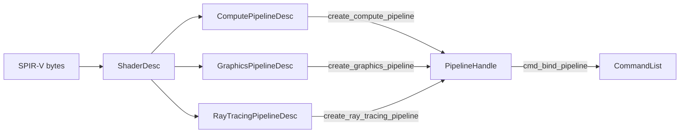

# Shaders and pipelines

[Documentation](../index.md) › [Public API](index.md) › Shaders and pipelines

Pipelines are created from SPIR-V. Their layout is fixed by the
[shader ABI](../shader_abi.md): one global heap set plus a root push block.
There is nothing to declare on the C3 side except the shader bytes.



## Shader input

```c3
const char[*] SPIRV = $embed("../shaders/main.comp.spv");
gpu::ShaderDesc shader = {
    .spirv       = SPIRV[..],
    .entry_point = "main",   // null selects "main"
    .debug_name  = "doubler",
};
```

The bytes and strings are borrowed for the create call only. Creation
reflects the entry point and validates the push block, heap bindings, and
stage interface. Mismatches return `SHADER_INVALID`. A module that declares
the `ClipDistance` capability, for example by writing `gl_ClipDistance`, needs
`caps.clip_distance`; one that declares `SampleRateShading`, for example by
reading `gl_SampleID` or `gl_SamplePosition`, needs `caps.sample_rate_shading`.
Otherwise pipeline creation returns `UNSUPPORTED_FEATURE`.

`entry_point` is null or between 1 and `MAX_SHADER_ENTRY_POINT_BYTES` bytes
long. This is a contract: a violation panics in safe builds.

## Compute pipelines

```c3
gpu::ComputePipelineDesc desc = { .shader = shader, .debug_name = "doubler" };
gpu::PipelineHandle pipeline = gpu::create_compute_pipeline(&device, &desc)!;
defer (void)gpu::destroy_pipeline(&device, pipeline);
```

## Graphics pipelines

```c3
gpu::Format[2] color_formats = { gpu::Format.RGBA16_FLOAT, gpu::Format.RGBA8_UNORM };
gpu::GraphicsPipelineDesc desc = {
    .vertex_shader      = { .spirv = VERT_SPIRV[..] },
    .fragment_shader    = { .spirv = FRAG_SPIRV[..] },
    .color_formats      = color_formats[..],
    .depth_format       = gpu::Format.D32_FLOAT,   // UNDEFINED for no depth
    .sample_count       = gpu::SampleCount.ONE,
    .min_sample_shading = 0.0f,                    // above 0 needs caps.sample_rate_shading
    .polygon_mode       = gpu::PolygonMode.FILL,   // LINE needs caps.line_polygon_mode
    .debug_name         = "scene",
};
gpu::PipelineHandle pipeline = gpu::create_graphics_pipeline(&device, &desc)!;
```

Pipeline identity is: shaders, color formats, depth format, sample count,
minimum sample shading, polygon mode. Everything else is command-time state
in `GraphicsState`:

| `GraphicsState` field | Type | Contents |
|---|---|---|
| `viewport` | `Viewport` | x, y, width, height, depth range |
| `scissor` | `ScissorRect` | x, y, width, height |
| `raster` | `DynamicRasterState` | topology, cull mode, front face, depth bias |
| `depth` | `DepthState` | test, write, compare |
| `color` | `ColorState` | one `ColorTargetState` per color format |

`render_geometry_state(width, height)` returns a full-area viewport and
scissor with triangles, no culling, no depth, and an empty color packet.
Fill `color.targets` before drawing:

```c3
gpu::GraphicsState state = gpu::render_geometry_state(width, height)!;
gpu::ColorTargetState[2] targets = {
    gpu::color_blend_disabled(),
    gpu::alpha_blend(),
};
state.color.targets = targets[..];
state.raster.cull_mode = gpu::CullMode.BACK;
state.depth = { .test_enable = true, .write_enable = true, .compare = gpu::CompareOp.LESS };
```

Blend presets return a `ColorTargetState`: `color_blend_disabled(mask)`,
`alpha_blend()`, `premultiplied_alpha_blend()`, `additive_blend()`.
`uniform_color_state(slice, state)` fills a slice with one state and
returns the `ColorState`. `COLOR_WRITE_ALL` is the default mask.

`MAX_COLOR_ATTACHMENTS` is 8; use `DeviceCaps.max_color_attachments` for
the selected device.

These descriptor rules are contracts that panic in safe builds when broken:
`color_formats` has at most `MAX_COLOR_ATTACHMENTS` entries and each is a
defined color format; `depth_format` is `UNDEFINED` or a depth-stencil
format; the pipeline has at least one color format or a depth format;
`sample_count` and `polygon_mode` are defined values. A mesh pipeline follows
the same rules for the fields it shares.

`min_sample_shading` is the fraction of a pixel's samples that run the
fragment shader in separate invocations. Zero shades a pixel once and
broadcasts the result to its covered samples. A value in `(0, 1]` makes the
rasterizer shade at least that fraction of the samples separately, and `1`
shades every sample. A value outside `[0, 1]`, or NaN, is a contract
violation that panics in safe builds; a value above zero without
`caps.sample_rate_shading` returns `UNSUPPORTED_FEATURE`. A fragment shader that reads `gl_SampleID` or
`gl_SamplePosition` shades every sample whatever the field says, because
Vulkan then treats the pipeline as sample-rate shaded at `1`. Negative zero
is the same pipeline as zero. The field has no effect on a single-sample
pipeline.

## Mesh pipelines

Require `DeviceDesc.enable_mesh_shaders`; a task shader also needs
`DeviceCaps.mesh_shaders.task_shaders`.

```c3
gpu::Format[1] mesh_targets = { gpu::Format.RGBA8_UNORM };
gpu::MeshPipelineDesc mesh_desc = {
    .mesh_shader     = { .spirv = MESH_SPIRV[..] },     // .task_shader is optional
    .fragment_shader = { .spirv = FRAG_SPIRV[..] },
    .color_formats   = mesh_targets[..],
    .debug_name      = "meshlets",
};
gpu::PipelineHandle mesh_pipeline = gpu::create_mesh_pipeline(&device, &mesh_desc)!;
```

Mesh pipelines take the same attachment state and `GraphicsState` as
graphics pipelines; `raster.topology` is ignored. They push the graphics root
header with `vertex_root_gpu` carrying the mesh (or task) root. Draw with
`cmd_draw_mesh_tasks` and its indirect forms. Applications must bind a mesh
pipeline for mesh draws and a graphics pipeline for vertex/indexed draws.
Generated work does not cover mesh draws.

## Ray-tracing pipelines

Require `DeviceDesc.enable_ray_tracing_pipelines`.

```c3
gpu::ShaderDesc closest_hit = { .spirv = CHIT_SPIRV[..] };
gpu::ShaderDesc[1] raygen = {{ .spirv = RGEN_SPIRV[..] }};
gpu::ShaderDesc[1] miss   = {{ .spirv = MISS_SPIRV[..] }};
gpu::RayTracingHitGroupDesc[1] hit_groups = {{
    .kind               = gpu::RayTracingHitGroupKind.TRIANGLES,
    .closest_hit_shader = &closest_hit,
}};
gpu::RayTracingPipelineDesc desc = {
    .ray_generation_shaders = raygen[..],
    .miss_shaders           = miss[..],
    .hit_groups             = hit_groups[..],
    .max_recursion_depth    = 1,          // 0 normalizes to 1
    .dynamic_stack_size     = false,
};
gpu::PipelineHandle pipeline = gpu::create_ray_tracing_pipeline(&device, &desc)!;
```

Hit groups: `TRIANGLES` may have closest-hit and any-hit shaders and no
intersection shader; `PROCEDURAL` requires an intersection shader. A null
shader pointer means the role is absent. `ray_generation_shaders` is
non-empty, no slice is null with a nonzero length, and the shader group and
stage counts fit `uint`. `max_recursion_depth` must not exceed
`DeviceCaps.ray_tracing_pipelines.max_recursion_depth`. These are contracts
that panic in safe builds when broken.

`get_ray_tracing_pipeline_info` returns the deterministic group order
(ray generation, miss, hit, callable ranges) and the normalized recursion
depth. `get_ray_tracing_shader_group_handles` copies handle bytes for a
group range into caller memory of `group_count * shader_group_handle_size`
bytes. `get_ray_tracing_shader_group_stack_size` reports the stack
requirement of one role in one group. The pipeline must be a ray-tracing
pipeline, `first_group + group_count` and `group` must lie inside its group
count, the output length must match, and the role must be present in the
group; these state rules also panic in safe builds when broken. With
`dynamic_stack_size = true` the
application sums them and records
`cmd_set_ray_tracing_pipeline_stack_size`. See the
[cookbook](../cookbook.md#pack-an-sbt-and-trace).

Not supported: pipeline libraries, capture replay, deferred creation,
automatic stack sizing.

## Lifetime

```c3
gpu::destroy_pipeline(&device, pipeline)!;
```

Destruction never waits. Recording, ending, or submitting commands does not
retain pipelines. Keep each pipeline alive through its last GPU use;
cached command state does not extend its lifetime.

Equal descriptions on one device share a private cached pipeline; each
`PipelineHandle` is still a separate owner with its own lifetime. Pipeline
calls are thread-safe.

## Pipeline cache

```c3
usz size = gpu::get_pipeline_cache_size(&device)!;
char[] blob = mem::new_array(char, (sz)size);
usz written = gpu::get_pipeline_cache_data(&device, blob)!;
// persist blob[:written]; next run: RuntimeDesc.pipeline_cache_data = blob
```

The blob is opaque, driver-specific data. Store it with the adapter's
vendor, device, and driver identifiers. A rejected blob is a cache miss.
`blob` must be at least the size `get_pipeline_cache_size` returns just before
the export, and the cache must not grow between the two calls; a shorter
buffer panics in safe builds.

## Faults

| Cause | Fault |
|---|---|
| bad SPIR-V, missing entry point, ABI mismatch | `SHADER_INVALID` |
| unsupported format, sample count, polygon mode, clip distance, or ray feature | `UNSUPPORTED_FEATURE` |
| driver rejected the pipeline | `PIPELINE_CREATE_FAILED` |
| pipeline table full | `SLOT_TABLE_FULL` |
